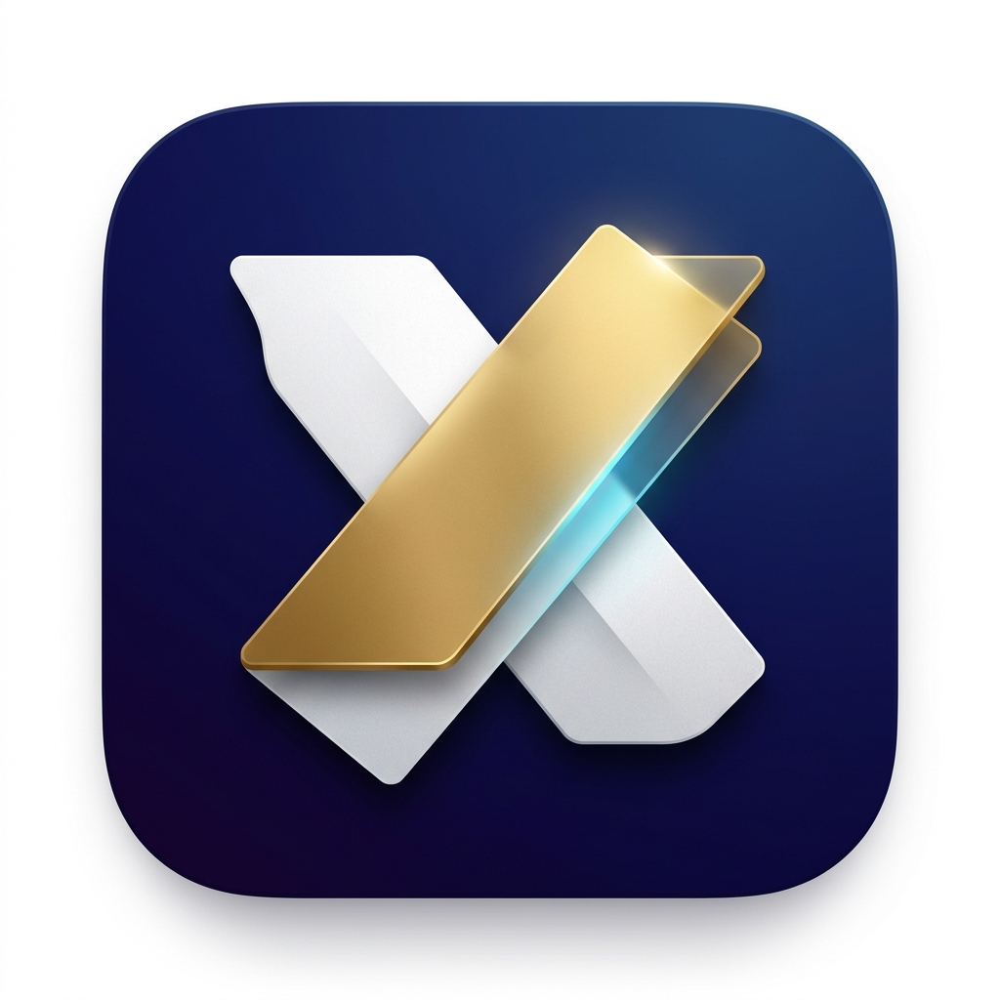

# 名刺X (Meishi X)

**名刺X** は、PCおよびiPad（タッチ・Apple Pencil操作）の両方に最適化した、「ラベル屋さん10」互換の高機能名刺・カード作成Webアプリケーションです。

## 主な機能

- **iPad & PC ユニバーサル対応**
  - Pointer Events による直感的なドラッグ移動、**大型タッチリサイズハンドル（当たり判定44px）**、回転ハンドルを搭載。
  - 挿入した画像やロゴをiPadでも指先やスライダー、ワンタッププリセット（小ロゴ12mm / 標準ロゴ22mm / 顔写真28mm / 全面配置）で自在にサイズ変更・角丸切り抜き・枠線設定可能。
- **A-one（エーワン）マルチカード 10面規格対応**
  - `51002` / `51861`（クリアエッジ）/ `51004` / `51131` 等の A4判10面（91×55mm、左余白14mm・上余白11mm）に対応。
- **Word並みの豊富なフォント（全35種類・7カテゴリー）**
  - 和文ゴシック体（游ゴシック、メイリオ、ヒラギノ角ゴ、BIZ UDPゴシック、極太ゴシック等）
  - 和文明朝体（游明朝、ヒラギノ明朝、凸版文久明朝、BIZ UDP明朝等）
  - 和文丸ゴシック体・教科書体・楷書体・行書体・クレー・ポップ体
  - 欧文サンセリフ・セリフ・筆記体・等幅フォント
  - **太字 (B) / 斜体 (I) / 下線 (U)**、**横書き・縦書き** 切り替え、文字間隔・行間調整に対応。
- **レイヤー順での複数選択＆まとめて削除**
  - 「レイヤー順」タブでチェックボックスによる複数要素選択・「すべて選択」・「選択した要素をまとめて削除」に対応。
- **表裏両面印刷（2ページ連続出力）＆縁線なしクリーン印刷**
  - 「表面のみ」「裏面のみ」「表裏両面（1P:表面 / 2P:裏面）」の印刷モードを搭載。
  - 裏面印刷時の左右列（1列目⇔2列目）自動反転位置合わせ機能、使いかけシートの部分印刷（1〜10面の個別ON/OFF）、0.5mm単位の給紙ズレ補正に対応。
  - 印刷時は用紙の縁線や切り取り枠線を一切描画しないクリーン出力仕様。

## 使い方

1. `index.html`（または `meishi_x.html`）をブラウザで開きます。
2. 「1. 用紙・テンプレ」からベースとなるデザインを選択するか、「2. デザイン編集」で文字・画像・QRコード・図形を自由に配置・編集します。
3. 「3. 10面プレビュー」で「表裏両面」または片面を選択し、**「A4・表裏両面 (2ページ) を印刷 / PDF保存」** または高解像度PNGダウンロードを実行します。
